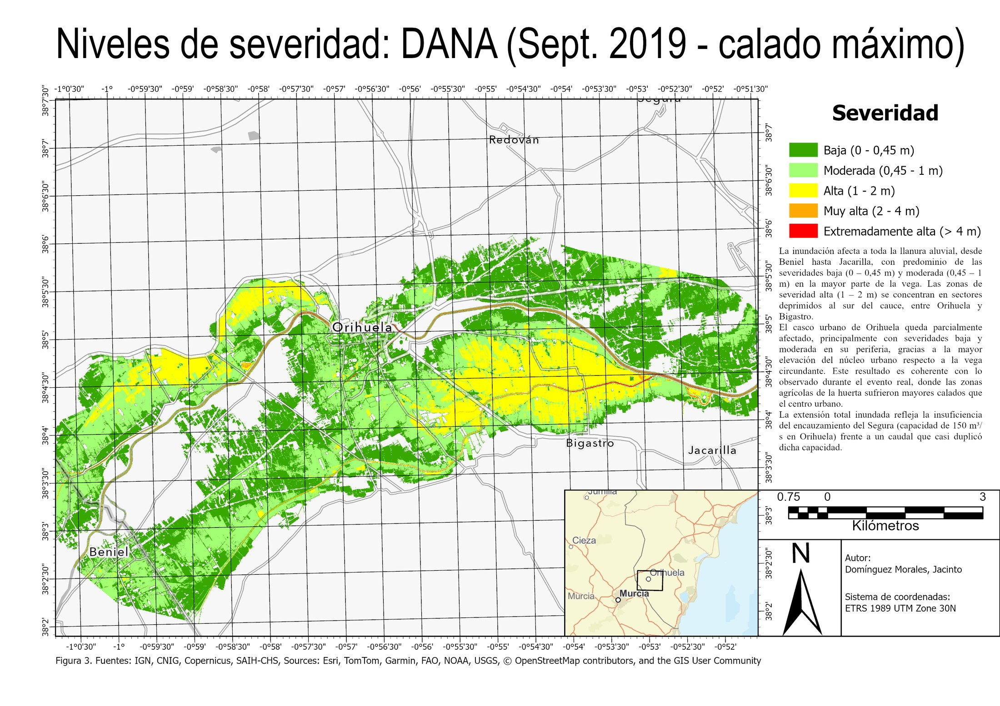
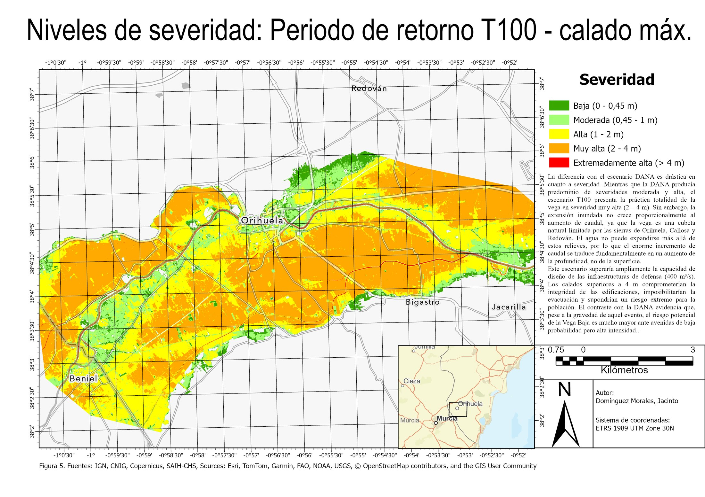
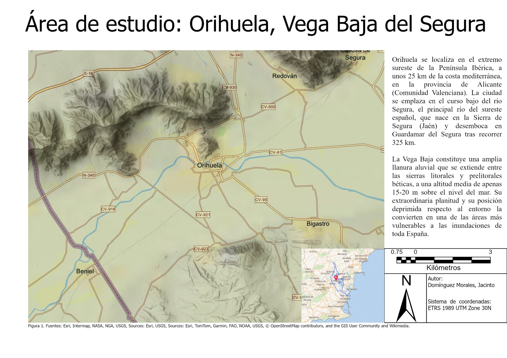
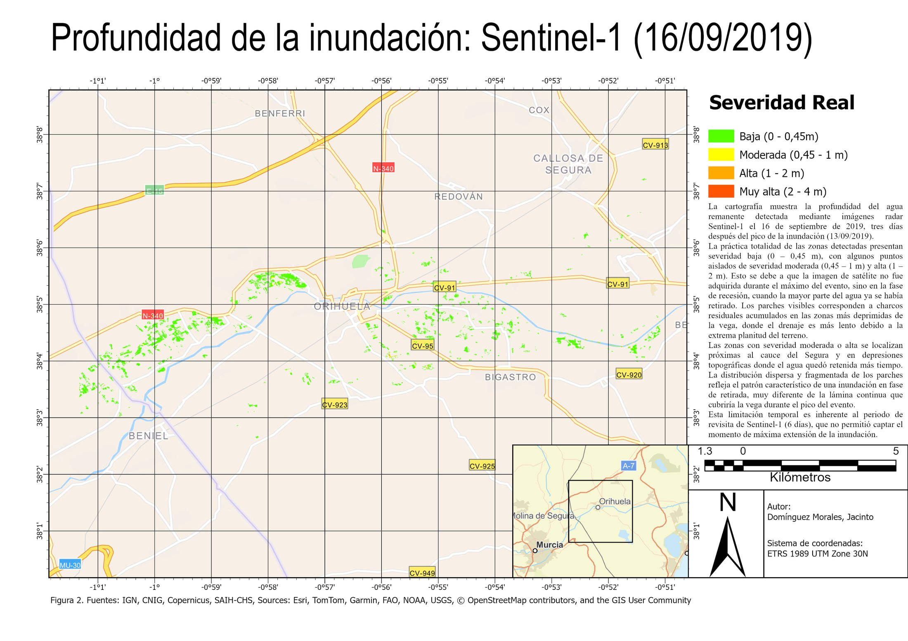
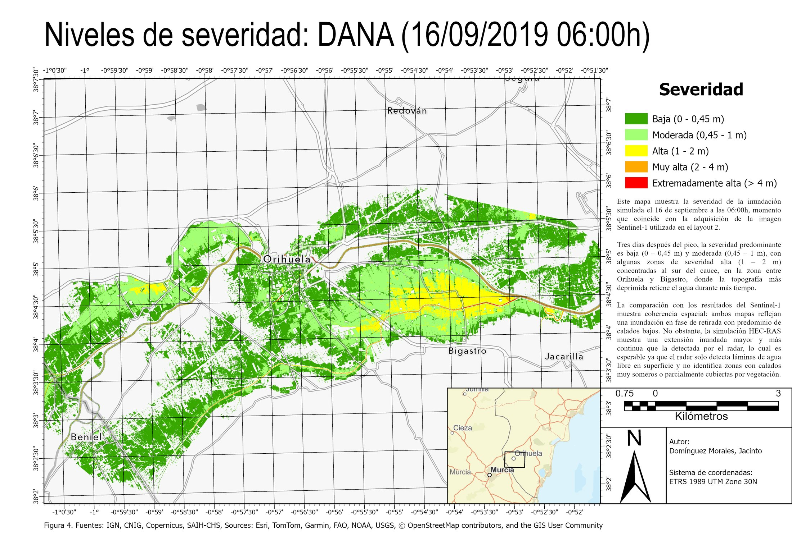
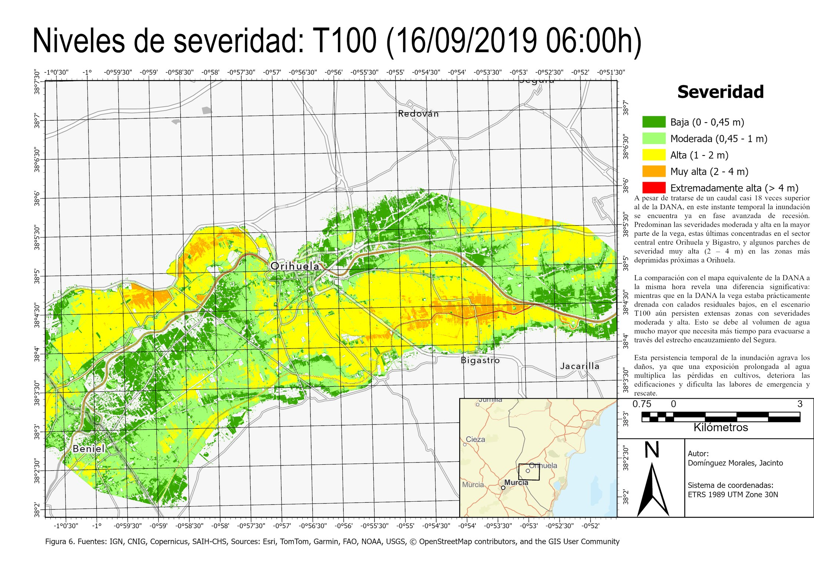
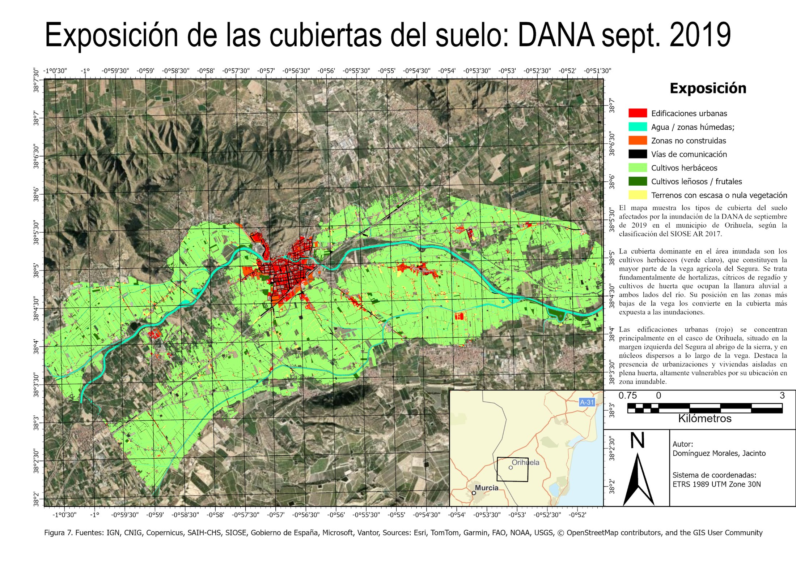
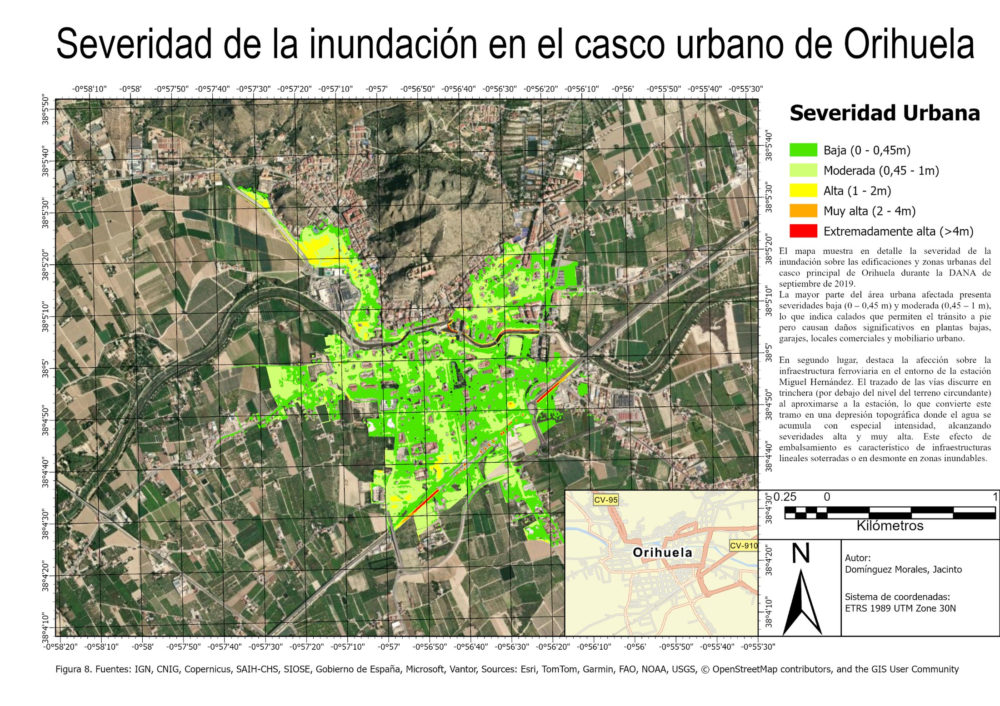

# Inundación de la DANA de septiembre de 2019 en Orihuela: radar Sentinel-1 y modelización HEC-RAS 2D

Análisis de la inundación de la Vega Baja del Segura (Orihuela, Alicante) durante la DANA de septiembre de 2019, desde tres enfoques complementarios: **teledetección radar**, **modelización hidráulica bidimensional** y **exposición de los usos del suelo**. La misma metodología se aplica a un escenario teórico de avenida con periodo de retorno de 100 años (T100).

Trabajo de la asignatura de Aplicaciones en Medio Ambiente del **Máster en Tecnologías de la Información Geográfica (Universidad Complutense de Madrid)**.

<table>
<tr>
<td></td>
<td></td>
</tr>
<tr>
<td align="center"><b>DANA 2019</b> · calado máximo simulado</td>
<td align="center"><b>Avenida T100</b> · calado máximo simulado</td>
</tr>
</table>

## Resultados principales

- La simulación del evento real inunda **3.451 ha**. El escenario T100 llega a **5.003 ha (+45 %)**.
- La diferencia más importante no está en la extensión sino en la **severidad**: en la DANA, el 80 % de la superficie inundada no supera 1 m de calado; en el T100, el **82 %** lo supera.
- Las **edificaciones urbanas** afectadas pasan de 104 ha a 215 ha. En la DANA, el 94 % del tejido urbano afectado tiene severidad baja o moderada; en el T100, el 60 % alcanza severidad alta o superior.
- Los **cultivos herbáceos** son la cubierta más expuesta en los dos escenarios: el 82 % de la superficie inundada en la DANA y el 77 % en el T100.
- La imagen Sentinel-1 del 16 de septiembre, tres días después del pico, recoge una inundación residual y fragmentada en las depresiones de la vega, coherente con el escaso drenaje de una llanura con pendientes inferiores al 0,5 ‰.

## Área de estudio

Unos 15 km del curso bajo del río Segura en torno a Orihuela, entre la estación de aforo de Beniel (Murcia) y Jacarilla.

## Datos

| Dato | Fuente | Uso |
|---|---|---|
| Sentinel-1B GRD, modo IW, VV+VH (04/09/2019 y 16/09/2019) | Copernicus Data Space Ecosystem | Detección de la inundación residual |
| MDT de 2 m (LiDAR PNOA, hoja 0913) | Centro de Descargas del CNIG (IGN) | Terreno del modelo y cálculo de profundidades |
| Hidrograma horario de Beniel (12-16/09/2019, punta de 271,7 m³/s) | SAIH Segura (CHS) | Condición de contorno aguas arriba |
| Caudal T100 (4.803 m³/s) | SNCZI | Escenario teórico de 100 años |
| SIOSE AR 2017, provincia de Alicante | Centro de Descargas del CNIG (IGN) | Exposición de las cubiertas del suelo |

Sistema de referencia de todo el proyecto: ETRS89 / UTM 30N (EPSG:25830).

## Metodología

### 1. Detección de la inundación con radar (SNAP + ArcGIS Pro)

- Preprocesado de las dos imágenes en **SNAP**: *Apply Orbit File* → *Thermal Noise Removal* → *Border Noise Removal* → *Calibration* (σ⁰) → *Speckle Filtering* → *Range Doppler Terrain Correction*. Se exporta la banda VV, la más sensible al agua en superficie.
- Conversión a decibelios (`10 × log10`) y **detección de cambios** entre fechas: un píxel se clasifica como inundado si está por debajo de −17 dB después del evento y por encima antes. Así se descartan el agua permanente y las sombras de radar.
- Vectorización, limpieza de falsos positivos (< 1.000 m²) y **estimación de la profundidad** combinando la cota del agua en el borde de cada mancha con el MDT de 2 m (interpolación IDW).

### 2. Modelización hidráulica 2D (HEC-RAS 6.6)

- Área de flujo 2D con malla de **25 × 25 m**, rugosidad de Manning **0,06** y **9 líneas de quiebre** (*breaklines*) en márgenes, motas y diques.
- Régimen no estacionario con ecuación de **onda difusa** y paso de cálculo de 1 minuto.
- Aguas arriba, el hidrograma real de Beniel (DANA) o el mismo hidrograma escalado al caudal T100. Aguas abajo, calado normal con pendiente de 0,005.
- Se exportan desde RAS Mapper el calado máximo y el calado del 16/09/2019 a las 06:00, este último para compararlo con la imagen de radar.

<table>
<tr>
<td></td>
<td></td>
</tr>
<tr>
<td align="center">DANA · 16/09/2019 06:00</td>
<td align="center">T100 · 16/09/2019 06:00</td>
</tr>
</table>

### 3. Severidad y exposición (ArcGIS Pro)

- Reclasificación de los calados en cinco niveles de severidad (Altarejos-García et al., 2012): baja (0–0,45 m), moderada (0,45–1 m), alta (1–2 m), muy alta (2–4 m) y extremadamente alta (> 4 m).
- Cruce (*Intersect*) con el SIOSE AR 2017 para cuantificar la superficie de cada cubierta en cada nivel de severidad.

Los diagramas de flujo de cada bloque están en [`diagramas/`](diagramas/).

## Tablas de resultados

**Superficie inundada por nivel de severidad**

| Severidad | DANA 2019 (ha) | % | T100 (ha) | % |
|---|---:|---:|---:|---:|
| Baja (0–0,45 m) | 1.573,8 | 45,6 | 312,0 | 6,2 |
| Moderada (0,45–1 m) | 1.193,2 | 34,6 | 582,6 | 11,6 |
| Alta (1–2 m) | 622,9 | 18,0 | 1.582,4 | 31,6 |
| Muy alta (2–4 m) | 52,8 | 1,5 | 2.489,1 | 49,8 |
| Extremadamente alta (> 4 m) | 8,9 | 0,3 | 36,6 | 0,7 |
| **Total** | **3.451,4** | 100 | **5.002,7** | 100 |

**Cubiertas del suelo afectadas**

| Cubierta (SIOSE AR) | DANA 2019 (ha) | T100 (ha) | Incremento |
|---|---:|---:|---:|
| Cultivos herbáceos | 2.832,3 | 3.841,2 | +35,6 % |
| Agua / zonas húmedas | 148,0 | 177,5 | +19,9 % |
| Vías de comunicación | 137,3 | 268,3 | +95,4 % |
| Terrenos con escasa vegetación | 113,9 | 264,4 | +132,0 % |
| Edificaciones urbanas | 104,2 | 215,4 | +106,7 % |
| Cultivos leñosos / frutales | 75,8 | 154,5 | +103,8 % |
| Zonas no construidas | 40,0 | 81,3 | +103,3 % |
| **Total** | **3.451,4** | **5.002,7** | **+45,0 %** |

## Limitaciones

- La imagen de radar es de tres días después del pico: recoge la inundación residual, no la máxima. Además, el radar no detecta bien el agua bajo vegetación densa ni en zonas urbanas.
- El escenario T100 escala el hidrograma de la DANA de forma proporcional. Es una simplificación: un hidrograma de diseño real tendría otra forma y otro volumen.
- Se usa un único coeficiente de Manning para toda la llanura. Un modelo de detalle lo asignaría por usos del suelo.
- No hay calibración con marcas de agua observadas. La comparación con el producto de Copernicus EMS (18/09/2019) es cualitativa.

## Software

SNAP (ESA) · HEC-RAS 6.6 (USACE) · ArcGIS Pro (Esri)

## Autor

**Jacinto Domínguez Morales** · [LinkedIn](https://www.linkedin.com/in/jacinto-dom%C3%ADnguez-morales-41376b163/)
